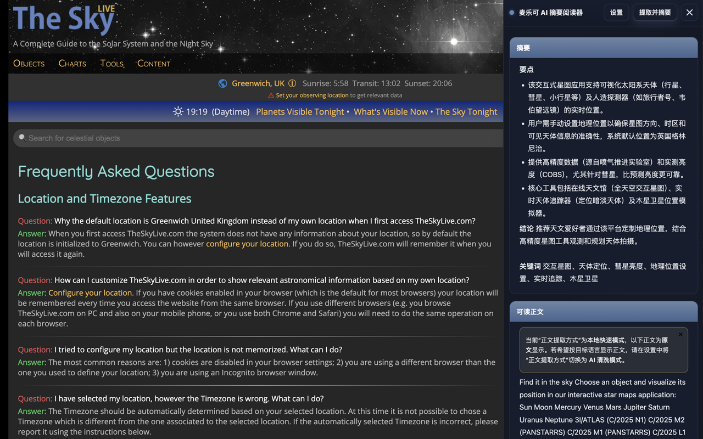
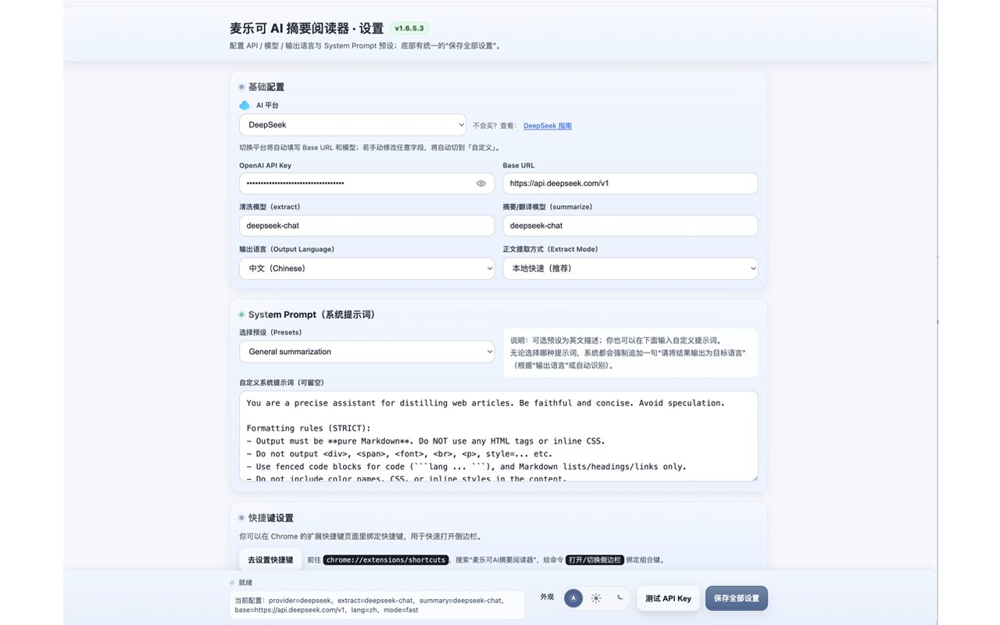
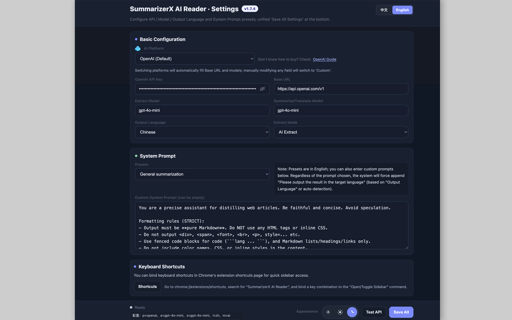
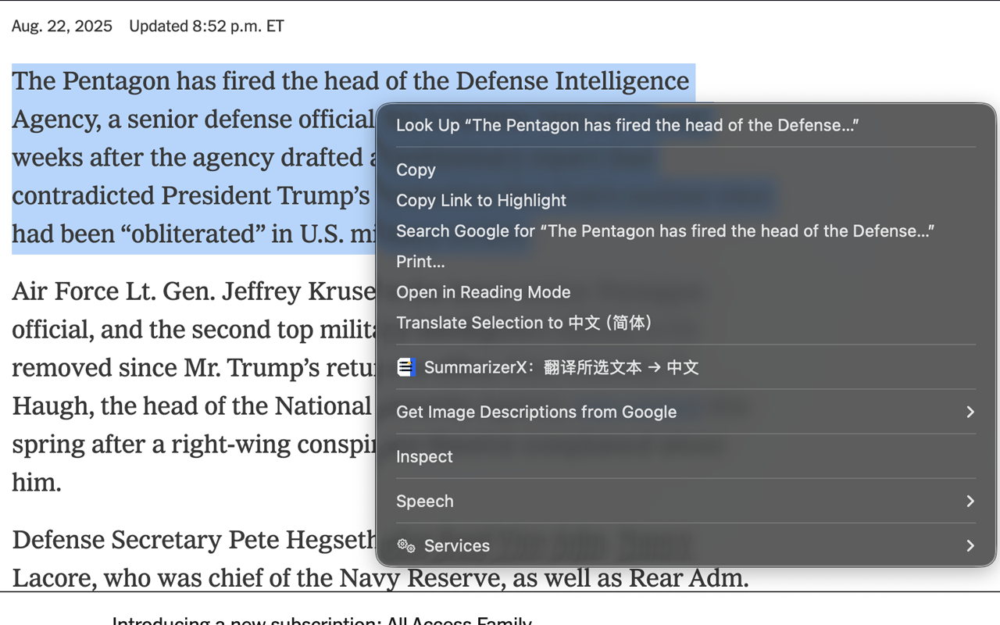
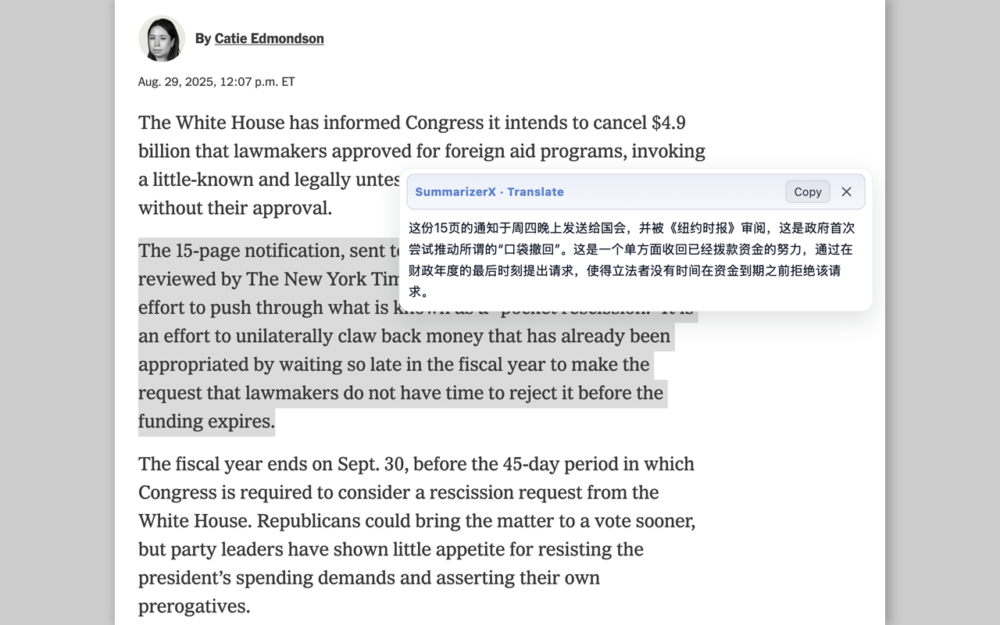
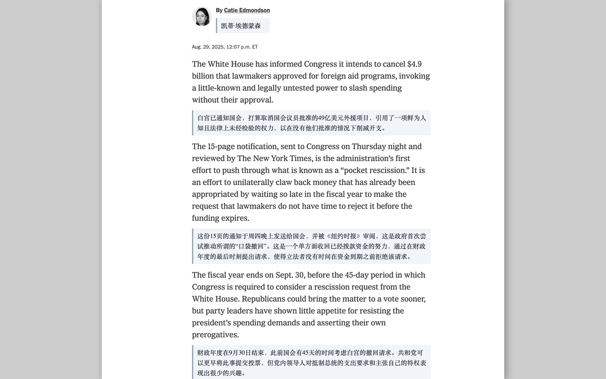

# Summary

[](LICENSE)

### Chrome Web Store / 官方页面

- English: Get it on the Chrome Web Store → <a href="https://chromewebstore.google.com/detail/summarizerx-ai-reader/okpefajonbfdnojdmobecjdajcohhoje?hl=en&authuser=0" target="_blank" rel="noopener noreferrer">SummarizerX AI Reader</a>
  - If you find it helpful, please consider leaving a **5-star review** — thank you!
- 中文：从 Chrome 应用商店安装 → <a href="https://chromewebstore.google.com/detail/summarizerx-ai-reader/okpefajonbfdnojdmobecjdajcohhoje?hl=en&authuser=0" target="_blank" rel="noopener noreferrer">SummarizerX AI Reader（官方页面）</a>
  - 如果觉得好用，诚邀给我们一个**五星好评**，非常感谢！

---

## English

Current stable: v2.3.14 (main branch)
Current dev build: v2.3.14 (dev/next branch)

**Summary** is a Chrome extension that helps you quickly extract, summarize, and translate webpage content with AI-powered enhancements. It offers a clean reading experience with customizable settings and a floating panel.

### ✨ Features

- 📰 Clean Content Extraction: Remove ads, navigation, and clutter for focused reading  
- 📖 Reader Mode Overlay: One‑click clean reading view in a centered dialog with a frosted header, separate vertical scrollbar (never covering the Close button), live theme sync (Auto/Light/Dark), and contained scrolling that doesn't move the page. Open it via the small book icon in the panel title bar.  
- 📄 **PDF AI Summarization**: Import and process PDF files (local or online URLs) with AI-powered summarization
  - Drag-and-drop or file picker to import PDFs in the floating panel
  - Preview PDF pages with navigation controls and page range selection
  - Select specific pages for summarization (e.g., "1-3,5" or "10-15")
  - Real-time validation with clear error messages
  - Integrated PDF.js for robust rendering and text extraction
  - Export Reader Mode to crisp A4 PDFs with robust CJK line wrapping (Chinese 40 chars/line, 90% width guard)
- 🤖 AI-Powered Summarization & Translation: Generate concise summaries or translations in one click — with built-in presets for OpenAI, DeepSeek, Anthropic Claude, Google Gemini, Azure OpenAI, or any custom-compatible endpoint  
- ⚡ Native Streaming Output: Summaries and Q&A render as tokens arrive for a much faster first response; automatically falls back to non-streaming APIs  
- ⚙️ Customizable Settings: Adjust prompts, modes, shortcuts, and UI preferences  
- 📑 Floating Panel: View summaries without leaving the current page  
- 🗂️ Summary History (new): Automatically stores per-page/PDF results, lets you reopen the panel and instantly reuse the latest summary, and browse/apply previous outputs via the in-panel History popover  
- 🌙 Theming Support: Light and dark modes for comfortable reading  
- ☁️ Cross-Device Settings Sync: Saves language, AI provider/API keys, prompts, and ad-filter toggles via `chrome.storage.sync`; checked ad lists auto-download after syncing so each machine stays up to date  
- 🖱️ Context Menu Translate: Right-click on selected text and instantly translate it with AI
- 🧾 Full Page Translate: Translate the entire visible page; show translations inline as quote blocks under the originals, and toggle via context menu (Translate full page / Show original)
- 🌍 Bilingual UI (中文/English): Switch in settings; all UI texts update instantly
- 🔁 Reader Translate (new): In Reader Mode, click “Translate Original” to progressively translate paragraph by paragraph. Choose translation backend from a dropdown: Free service (Cloudflare Worker + Gemini 2.5‑flash) or your Settings provider (ChatGPT/OpenAI, DeepSeek, Trial, Custom). It caches completed blocks and lets you toggle Show Original/Show Translation. An in-button progress bar shows progress and adapts to light/dark.
- 💬 Page Q&A Chat: Ask about the current page via a bubble chat UI (user right, AI left) with a typing indicator and tidy Markdown answers; smart scrolling aligns long answers to the top, short answers scroll to bottom
- 🔍 Inline Translate Zoom: Per-paragraph +/- zoom for long quote blocks, controls pinned at the top-right with hover lift; text never overlaps controls
- 🔊 Inline Speech Playback: When translating English → Chinese (selection bubble or full-page blocks), tap the speaker icon to hear the original text via browser speech synthesis—no extra permissions required.
- ⌨️ Triple-Space Typing Translate: Type in any text field, press space three times, and we translate your draft into English using your configured AI backend. A themed spinner badge shows progress and surfaces errors inline.
- ⚡ Vue.js Integration: Modern reactive UI with improved performance and user experience
- 🎯 Smart Layout Alignment: Intelligent positioning for full-page translations that adapts to complex website layouts (CSS Grid, responsive design)
- 🌙 Force Dark Mode: Toggle to force dark mode on any webpage with optimized text colors for better readability (now powered by Dark Reader’s dynamic engine; see Credits)
 - ✅ Consistent Consent Pulse: Trial consent attention “breathing” animation now behaves the same in light and dark themes
- 🛡️ Ad Filtering (ABP 2.0 cosmetic): Enable in Settings → 广告过滤 (now below System Prompt). Choose global/regional lists (EasyList, EasyPrivacy, Fanboy’s, etc.) and the new Cookie Notice Hiding category (EasyList Cookie General Hide). Per‑list sync, Low/Medium/High strength, and auto-sync on selection (checked lists download immediately). Rules are stored locally and applied per‑host.
  - 🧰 Element Hiding Picker: In the floating panel footer, click “Hide element”, then click any element to create a per-domain cosmetic rule; Confirm exits the picker; Cancel continues; press Esc to exit. The picker hides all matches on the current page immediately, and saves the rule under Settings → Ad Filtering → Custom hides. Tip: Medium strength is recommended when using custom/user rules.
  - ▶️ Video ads (site packs): NYTimes + CNN/Reuters/Bloomberg/Guardian/Yahoo/CNET — use session-scoped DNR to redirect specific ad modules (e.g., Betamax ads, IMA3) to safe stubs and block FreeWheel/GPT/Amazon/Media.net with initiator scoping to avoid side effects. Rules load only while a tab of the site is open.
  - 🗂 Settings tabs: Top tabs (AI Summary / Ad Filtering) for clearer navigation; polished tab visuals, gradient underline, and unified header/card background.
  - 🧩 NYTimes: optional toggle to hide the “Family subscriptions / All Access Family” upsell popup (off by default for fresh installs), now patched to also suppress the latest sticky bottom subscription banner. Adblock main switch and popup blocker are also off by default on first install.
  - ℹ️ Safety: Avoid collapsing ChatGPT/OpenAI sticky UI when cleaning floating overlays

### 🖼 Screenshots

<p align="center">
  
</p>
<p align="center">
  
</p>
<p align="center">
  
</p>
<p align="center">
  
</p>
<p align="center">
  
</p>
<p align="center">
  
</p>
<p align="center">
  
</p>

### 🚀 Installation

1. Clone the repository:  
   ```bash
   git clone https://github.com/mallocfeng/SummarizerX.git
   ```
2. Open Chrome extensions page: `chrome://extensions/`  
3. Enable **Developer Mode**  
4. Click **Load unpacked** and select the project folder  

> Note: Do not load ZIP files directly; unzip first.

### ⚡ Quick Start

- Click the **Summary** icon in the toolbar to open the floating panel  
- Select text or let it auto-extract the main content  
- Choose summarize or translate options  
- **For PDFs**: Click the PDF icon in the panel header, drag-and-drop a PDF file, then select page ranges for AI summarization
- Customize prompts and modes in settings  
- Use the new **right-click menu** to translate selected text instantly
 - Use **Translate full page** from the right-click menu to insert translations below each paragraph as quote blocks; switch back via **Show original**

#### Q&A Chat
- In the floating panel, type your question in the bottom bar; press Enter (Shift+Enter for newline) or click Send.
- The panel expands with a progress bar. Bubbles appear (you on the right, AI on the left). Answers render with tidy Markdown.
- During chat, the Summary/Readable cards are hidden. Click **Extract & Summarize** to fade the chat away and restore the two cards.

### ⚙️ Settings Reference

- **Prompt templates:** Customize AI instructions  
- **Default mode:** Summarize, translate, or AI rewrite  
- **Keyboard shortcuts:** Configure quick actions  
- **Theme:** Light or dark mode  

### 🎨 Theming

Supports light and dark themes to reduce eye strain and match your browser preferences.

### 🔒 Privacy

All processing happens locally or via your configured AI API key. No data is sent to third parties without your consent.

### 🛠 Troubleshooting

- If extraction fails, try selecting text manually  
- Reload the extension or browser if UI glitches occur  
- Check console logs for errors in developer tools  

### 🧭 Translation Mode — Output Rules

- **English**: In translation mode, AI outputs plain text only. No Markdown, no quotes, no extra commentary. Preserve paragraph breaks.
- **中文**：翻译模式下严格输出纯文本；不包含 Markdown/引号/额外说明，保持原段落换行。

## 中文简介

当前稳定版：v2.3.14 (main分支)
当前开发版：v2.3.14 (dev/next分支)

**Summary** 是一款 Chrome 浏览器扩展，利用 AI 技术快速提取、摘要和翻译网页内容，提供简洁流畅的阅读体验和丰富的个性化设置，支持浮动面板查看摘要。

### ✨ 功能亮点

- 📰 干净的内容提取：去除广告、导航和杂乱内容，专注阅读  
- 📖 阅读模式浮窗：一键打开居中的干净阅读视图，带磨砂标题栏；正文拥有独立的垂直滚动条（不会遮住关闭按钮），并与侧栏外观（自动/浅色/深色）实时联动；滚动事件被容器吸收，不会带动背景页面。点击侧栏标题行的小书图标即可打开。  
- 📄 **PDF AI 摘要**：导入并处理 PDF 文件（本地或在线链接），支持 AI 驱动的摘要功能
  - 在浮动面板中通过拖拽或文件选择器导入 PDF
  - 预览 PDF 页面，支持导航控制和页面范围选择
  - 选择特定页面进行摘要（例如："1-3,5" 或 "10-15"）
  - 实时验证，提供清晰的错误提示
  - 集成 PDF.js 实现稳定的渲染和文本提取
  - 阅读模式可导出为 A4 PDF，中文强制换行（每行 40 字、90% 宽度守卫），多页切片清晰无拉伸
- 🤖 AI 驱动的摘要与翻译：一键生成简洁摘要或翻译  
- ⚡ 原生流式输出：摘要与问答逐字输出，首帧响应大幅加快；接口不支持 SSE 时自动回退  
- ⚙️ 个性化设置：自定义提示词、模式、快捷键和界面偏好  
- 📑 浮动面板：无需跳转页面即可查看摘要  
- 🗂️ 摘要历史（新增）：自动保存每个页面或 PDF 的摘要记录，重新打开浮窗即可恢复最近结果，还可通过面板内的“历史”弹窗浏览、复制、套用以往摘要  
- 🌙 主题支持：明亮和暗黑模式，保护视力  
- 🖱️ 右键菜单翻译：在网页中选中文本，右键即可快速调用 AI 翻译
 - 🧾 全文翻译：将整页可见内容按段落翻译，在原文下方以引用块内联展示；可在右键菜单“全文翻译 / 显示原文”间切换  
 - 🌍 双语界面（中文/English）：设置页可切换语言，界面文案即时更新
 - 🔁 阅读模式翻译（新增）：在阅读模式点击“翻译原文”，系统会按段落逐步翻译并即时替换。下拉菜单可选择后端：免费服务（Cloudflare Worker + Gemini 2.5‑flash）或“设置中的服务”（ChatGPT/OpenAI、DeepSeek、试用、自定义）。已完成的段落会缓存，支持“一键切换 显示原文/显示翻译”，按钮自带背景进度条并适配明暗主题。
 - 💬 你问我答：在浮窗底部输入并发送，进入基于当前网页的气泡对话（用户在右、AI 在左）；带三点打字指示、整洁的 Markdown 排版；智能滚动（长回答顶部对齐，短回答自动滚到底部）
 - 🔍 全文对照放大：对较长段落的引用块提供每段 +/- 放缩；控制按钮固定在右上角并带轻微悬停上浮，文本不会与按钮重叠
 - ⚡ Vue.js 集成：现代化响应式界面，提升性能和用户体验
 - 🎯 智能布局对齐：全文翻译智能定位，适配复杂网站布局（CSS Grid、响应式设计）
- 🌙 强制深色模式：开关控制强制任何网页开启深色模式，优化文字颜色确保可读性（现已采用 Dark Reader 的动态主题引擎；见致谢）
 - ✅ 试用同意提示一致：需要同意时的“呼吸”动画在明亮/暗黑主题下表现一致
- 🛡️ 广告过滤（ABP 2.0 元素隐藏）：在设置 → 广告过滤（现位于“系统提示词”下方）开启；可选全球/区域列表（EasyList、EasyPrivacy、Fanboy’s等）和“Cookie 提示隐藏”分类（内置 EasyList Cookie General Hide）。支持单条规则“同步更新”、勾选后自动同步、高/中/低强度；规则本地保存，并按站点应用以隐藏/去除广告元素。
  - 🧰 隐藏元素选择器：在浮窗底部点击“隐藏元素”，再点击页面中的元素即可生成“按域名”的外观隐藏规则；“确认添加”会立即退出选择模式并隐藏当前页所有匹配元素；“取消”继续选择；按 Esc 退出。规则保存在 设置 → 广告过滤 → 自定义隐藏。提示：使用自定义/用户规则时，建议将过滤强度设为“中”。
  - ▶️ 视频广告（站点包）：NYTimes + CNN/路透/彭博/卫报/Yahoo/CNET — 使用“会话规则（DNR）”在仅打开目标站点时重定向特定广告模块（如 Betamax ads、IMA3）到安全空实现，并按站点限定阻断 FreeWheel/GPT/Amazon/Media.net，降低副作用。
  - 🧩 纽约时报：新增可选开关，默认屏蔽 “Family subscriptions / All Access Family” 弹窗，并已修复最新上线的底部订阅浮层提示。广告过滤总开关与弹窗拦截首次安装保持关闭。
  - 🗂 设置页标签：新增顶部标签（AI 摘要 / 广告过滤）与样式优化；保留渐变下划线并与首张卡片上浮联动；统一标题栏/卡片色调，视觉更自然。
  - ℹ️ 安全：在清理浮动遮罩时，避免误隐藏 ChatGPT/OpenAI 的粘附式界面元素

### 🖼 软件截图

<p align="center">
  
</p>
<p align="center">
  
</p>
<p align="center">
  
</p>
<p align="center">
  
</p>
<p align="center">
  
</p>
<p align="center">
  
</p>
<p align="center">
  
</p>


### 🚀 安装方法

1. 克隆仓库：  
   ```bash
   git clone https://github.com/mallocfeng/SummarizerX.git
   ```
2. 打开 Chrome 扩展页面：`chrome://extensions/`  
3. 启用 **开发者模式**  
4. 点击 **加载已解压的扩展程序**，选择项目文件夹  

> 注意：请先解压，不要直接加载 ZIP 文件。

### ⚡ 快速开始

- 点击工具栏中的 **Summary** 图标，打开浮动面板  
- 选中文本或自动提取正文  
- 选择摘要或翻译功能  
- **PDF 处理**：点击面板标题栏的 PDF 图标，拖拽 PDF 文件或选择文件，然后选择页面范围进行 AI 摘要
- 在设置中自定义提示词和模式  
- 使用新增的 **右键菜单翻译** 功能，立即翻译所选文本
 - 在网页空白处右键选择 **全文翻译**，系统会在每段原文下方插入引用块译文；需要恢复时选择 **显示原文**
 - 使用 **全文翻译** 右键菜单，在原文下方以引用块展示译文，并可在"全文翻译 / 显示原文"间切换

### ⚙️ 设置说明

- **提示词模板：** 自定义 AI 指令  
- **默认模式：** 摘要、翻译或 AI 重写  
- **快捷键：** 配置快速操作  
- **主题：** 明亮或暗黑模式  

### 🎨 主题支持

支持明亮和暗黑主题，减少眼睛疲劳，适配浏览器偏好。

### 🔒 隐私说明

所有处理均在本地或通过您配置的 AI API 密钥完成，未经允许不会发送数据给第三方。

### 🛠 常见问题

- 提取失败时，尝试手动选中文本  
- UI 异常时，重启扩展或浏览器  
- 使用开发者工具查看控制台日志排查错误  

### 🧭 翻译模式输出规则

- **中文**：翻译模式下严格输出纯文本；不包含 Markdown/引号/额外说明，保持原段落换行。
- **English**: In translation mode, AI outputs plain text only. No Markdown, no quotes, no extra commentary. Preserve paragraph breaks.


## 📜 License

MIT License © 2025 [Malloc Feng](https://github.com/mallocfeng)

## 🙏 Credits / 致谢

- Force Dark Mode is powered by the excellent open‑source project Dark Reader (MIT): https://github.com/darkreader/darkreader. Thank you to the Dark Reader team and contributors. The upstream LICENSE is included at `vendor/DARKREADER_LICENSE`.
- Readable Body extraction (offline, non‑AI) uses Mozilla Readability (Apache‑2.0): https://github.com/mozilla/readability. Many thanks to the Mozilla Readability authors and contributors. The upstream LICENSE is included at `vendor/READABILITY_LICENSE`.
- 强制深色模式基于优秀的开源项目 Dark Reader（MIT）：https://github.com/darkreader/darkreader。感谢 Dark Reader 团队与所有贡献者。上游 LICENSE 已包含于 `vendor/DARKREADER_LICENSE`。
- 可读正文（离线、本地快速模式）集成了 Mozilla Readability（Apache‑2.0）：https://github.com/mozilla/readability。感谢 Readability 的作者与所有贡献者。上游 LICENSE 已包含于 `vendor/READABILITY_LICENSE`。
